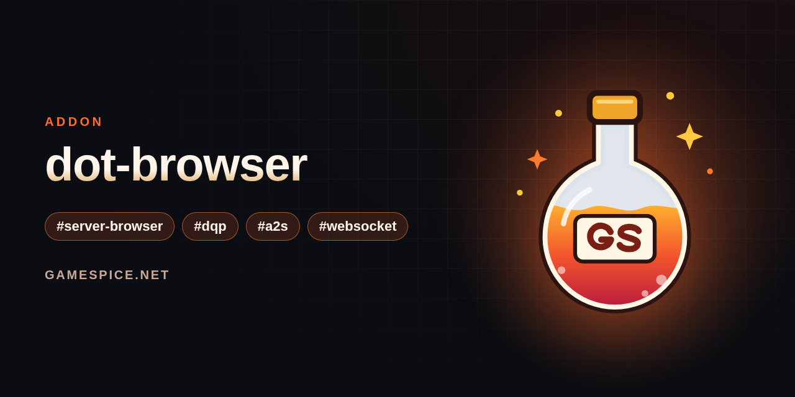

[](https://moddingcommunity.com/a/35-gs-browser)

A server browser for Godot 4.7+: a query client and a list model. It asks game servers what they are, then gives you sources, filters, sorting, favourites and history. Part of the [GameSpice](https://github.com/gamespice-platform) family. It needs only [GameSpice Core](https://github.com/gamespice-platform/core).

GameSpice Browser is a GameSpice addon, MIT licensed and built with Claude Code. Test it headless with `res://examples/browser_selftest.tscn`. The games in [Zee's Games](https://zeesgames.com) are built on the GameSpice addons and run on live servers, which are what its lists show.

It speaks three protocols, so one browser can list any server:

| Protocol | Used for |
| --- | --- |
| DQP over UDP | Servers made with [GameSpice Server Query](https://github.com/gamespice-platform/server-query). |
| DQP as JSON over a WebSocket | Browser (web) builds, which cannot open a UDP socket. Picked automatically when the platform has no UDP. |
| A2S | Existing servers and tools that speak nothing else. |

GameSpice Server Query is what this asks, but it is not a dependency. The wire formats are implemented here.

## Install

1. Copy `addons/gs_browser/` and `addons/gs_core/` into your project.
2. Enable gs-browser in *Project > Project Settings > Plugins*.

## Quick start

```gdscript
var browser := GSBrowser.new()
browser.add_source(GSBrowserSourceList.of(PackedStringArray([
    "eu1.example.com:27015",
    "127.0.0.1:27016",
])))
browser.entry_updated.connect(func(entry: GSBrowserEntry) -> void:
    table.redraw(entry))
add_child(browser)

await browser.refresh()

for entry in browser.filtered():
    print(entry.describe())
    # 127.0.0.1:27016  A dot server  dm_atrium  8/32  14 ms
```

To ask one server everything, for a details panel:

```gdscript
await browser.query(entry.target, PackedStringArray(["info", "players", "rules"]))
for player in entry.player_list:
    print(player["name"], player["score"])
```

## Sources

A browser knows how to ask a server what it is. A source says which servers exist. A source produces addresses, never player counts: what a server is, is what the server says when asked.

| Source | What it gives |
| --- | --- |
| `GSBrowserSourceList` | Addresses typed in, or a JSON file you ship. |
| `GSBrowserSourceBackbone` | A site's server listing (`GET /api/content/server/list`), read anonymously over HTTP. Off until `GSBrowserBackboneConfig.backbone_url` is set (`--browser-backbone-url` or `GS_BROWSER_BACKBONE_URL`). |
| Your own | Subclass `GSBrowserSource` and return targets. |

## Settings

The defaults are shown.

| Setting | Default | What it does |
| --- | --- | --- |
| `concurrency` | 8 | Queries in flight at once during a refresh. Default 8, 0 = unlimited; negative is refused, and above 256 (or 0) a refresh warns. |
| `timeout_ms` | 2500 | How long to wait for a server. |
| `retries` | 1 | Extra tries after a timeout. |

## Things the browser gets right

| Problem | What it does |
| --- | --- |
| A2S counts humans plus bots as players. | Reports the bot count separately, so a server with eight bots is not shown as an eight-player server. |
| Multi-packet replies from many servers arrive interleaved. | Stitches each reply by its own server and id. |
| A refresh of many servers can hang. | Runs the fan-out with a bounded number of queries at a time. |

## Test

```bash
godot --headless --path . --import
godot --headless --path . res://examples/browser_selftest.tscn
```

The self-test includes a real query over a loopback socket and exits non-zero on any failure. The design is in [docs/design.md](docs/design.md).

## Used by

These games vendor it:

- [Fatal Contact](https://zeesgames.com/fatal-contact)
- [Airdrift](https://zeesgames.com/airdrift) - the in-game server list
- [Playlot](https://zeesgames.com/playlot)
- [Hungario](https://zeesgames.com/hungario)
- [Zombie Zone](https://zeesgames.com/zombie-zone)

The whole collection is at [zeesgames.com](https://zeesgames.com).

## Licence

MIT. See [LICENSE](LICENSE). Only the TMC back-end web infrastructure is not open source.
